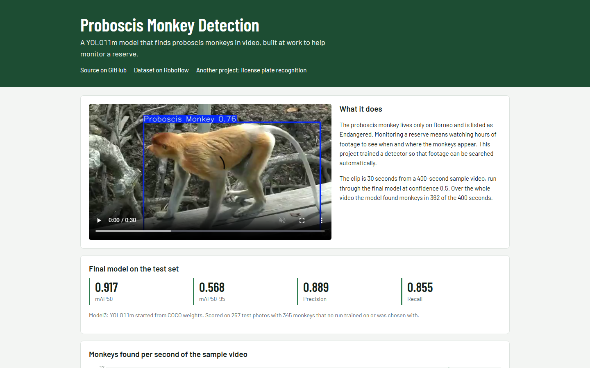

# Proboscis Monkey Detection (YOLO11)

**Live page: https://weikang14.github.io/proboscis-monkey-detection/**

A YOLO11m model that finds proboscis monkeys in video, built at work to help monitor a reserve. The dataset was labelled by hand, six models were trained on five versions of it, and every model was then re-scored on the same test photos to choose the final one.



## Background and goal

The proboscis monkey (*Nasalis larvatus*) lives only on Borneo and is listed as Endangered. Monitoring a reserve means watching hours of camera footage to see when and where the monkeys appear. The goal of this project was a detector that finds them in that footage automatically, so the footage can be searched instead of watched.

## Dataset

[Proboscis detector on Roboflow Universe](https://universe.roboflow.com/chua-wei-kang/proboscis-detector-ybjuj), one class.

- 772 training photos labelled by hand, plus 258 validation and 257 test photos (345 monkeys in the test photos).
- Five versions were exported. Each later version adds augmented copies of the same 772 photos: 772, 983, 1,353, 1,544 and 2,316 training images. The last version's copies use flips, 90° rotations and up to 5% changes in brightness and exposure.
- The validation and test photos and their labels are identical in every version, so every run can be compared on them.

## Training runs

All runs use YOLO11m at image size 640 and batch 16. `tools/build_site_data.py` re-scores each run's best weights on the shared test photos with the same settings (NMS IoU 0.7).

| Run | Training images | Starting weights | Best epoch | Validation mAP50 (logged) | Test mAP50 | Test mAP50-95 | Precision | Recall |
|---|---|---|---|---|---|---|---|---|
| Model_ori | 772 | from scratch | 299 of 399 | 0.911 | 0.900 | 0.566 | 0.899 | 0.861 |
| Model_1 | 983 | from scratch | 241 of 341 | 0.916 | 0.907 | 0.565 | 0.918 | 0.843 |
| Model_1.5 | 1,353 | from scratch | 309 of 409 | 0.914 | 0.886 | 0.551 | 0.916 | 0.825 |
| Model_2 | 1,544 | from scratch | 123 of 223 | 0.921 | 0.908 | 0.547 | 0.912 | 0.841 |
| **Model3 (final)** | 2,316 | COCO pre-trained | 76 of 100 | 0.857 | **0.917** | **0.568** | 0.889 | 0.855 |
| Model3.2 | 2,316 | continued from Model3 | 87 of 150 | 0.865 | 0.908 | 0.564 | 0.912 | 0.869 |

Model3 has the highest test mAP50 and mAP50-95, so it is the final model (`models/proboscis.pt`). On the 400-second sample video it found monkeys in 362 seconds at confidence 0.5.

## What the experiments showed

- **More copies of the same photos did not help.** Growing the training set from 772 to 2,316 images kept test mAP50 between 0.886 and 0.917, because every added image is a copy of one of the same 772 photos. The next gain has to come from newly labelled photos.
- **Pre-trained weights converged faster, not higher.** Started from COCO weights, Model3 reached its best validation score at epoch 76; the runs from scratch needed 123 to 309 epochs. On the test set they score about the same. Model3 also changed other settings (dropout 0.9, learning rate 0.001, copy-paste 0.5), so the speed-up cannot be put on the weights alone.
- **One setting made the best model look like the worst.** Model3 and Model3.2 were trained with NMS IoU 0.9, which keeps overlapping duplicate boxes, so their validation mAP50 during training was the lowest of the six. Scored again on the same validation photos at the default 0.7, Model3 goes from 0.858 to 0.928 and is the best run on the test set. Runs can only be compared under the same evaluation settings.

## Limitations and next steps

The model knows one class. It has not been tested on other primates that share the habitat, such as macaques, so false alarms on them are unmeasured. Each frame is scored on its own, so a monkey that stays in view for a minute is found again in every frame rather than counted once.

1. Label more new photos instead of making more copies of the same ones.
2. Track monkeys across frames, so the system can count individuals and log when each one appears.
3. Add photos of other primates to measure and reduce false alarms.

## Who built what

- **weikang14, as a project at work:** labelling the dataset and training every model. The company is not named here.
- **Built with [Claude Code](https://claude.com/claude-code), an AI coding assistant:** this page, re-scoring the runs on one test set (`tools/build_site_data.py`) and the demo clip.

## Repository layout

```
models/proboscis.pt          final model (Model3, YOLO11m)
training_results/<run>/      args, metrics per epoch and plots of each run
tools/build_site_data.py     re-scores every run on the test photos, renders the demo clip, writes web/data/
tools/serve.py               local static server (supports video seeking)
web/                         the page (plain HTML, CSS, JS and Chart.js)
tests/                       checks that this README matches web/data/site.json
```

## Run it

```
python tools/serve.py        # then open http://127.0.0.1:8765
```

Rebuilding the site data needs Ultralytics 8.3 or newer, a CUDA GPU, ffmpeg, the run folders with their weights and the dataset (not in this repository):

```
python tools/build_site_data.py --runs path/to/Trains --dataset path/to/Datasets --video path/to/sample.mp4
python -m pytest tests
```

Detect monkeys in your own video with the final model:

```
yolo detect predict model=models/proboscis.pt source=your_video.mp4 conf=0.5
```
